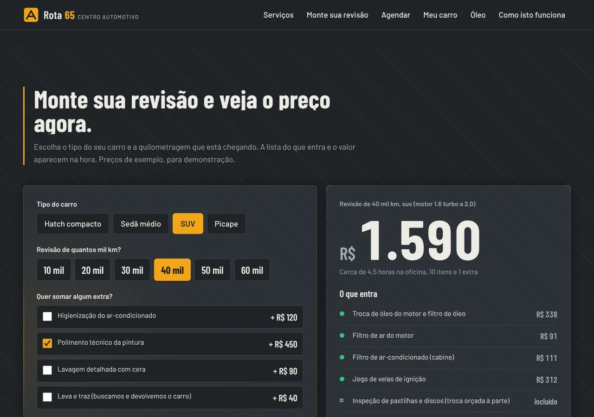
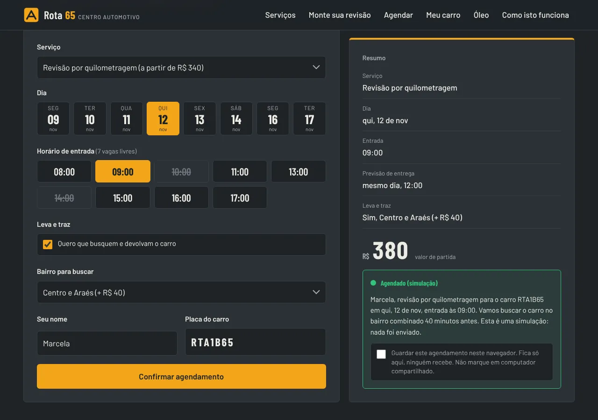
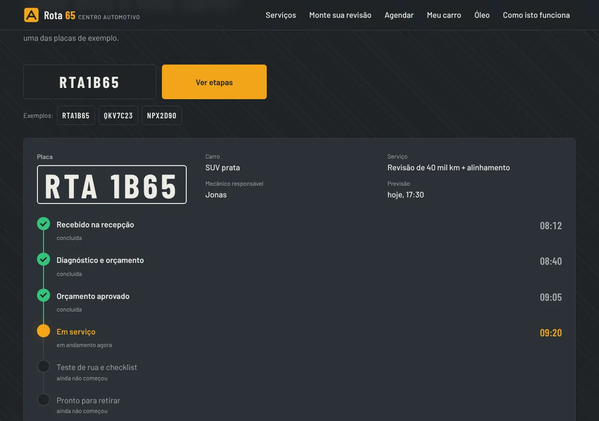
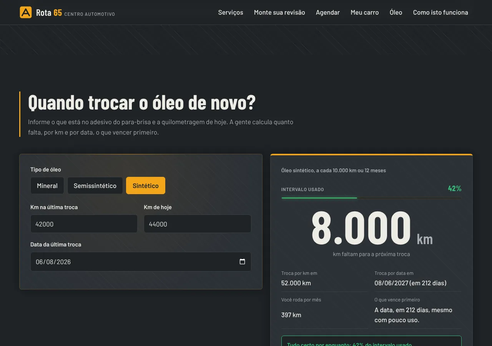

# Rota 65 Centro Automotivo

Eu sou o Rodrigo Jr, da [Mil e Uma Linhas!](https://mileumalinhas.com.br), em Cuiabá. Este site é uma demonstração que eu fiz para mostrar a oficinas mecânicas e centros de estética automotiva como pode ser o site delas: com cara própria, rápido, funcionando no celular e fazendo coisas úteis de verdade, não só mostrando fotos.

Publicado em: https://toshiro01001.github.io/automotivo/

## O que é, para quem não entende de tecnologia

É o site de uma oficina que não existe, a "Rota 65". Nele a pessoa:

- monta a revisão do carro (tipo de carro + quilometragem) e vê o preço e a lista do que entra, na hora;
- marca dia e horário, com a opção de a oficina buscar e devolver o carro;
- digita a placa e vê em que etapa o carro está, com o horário de cada passo;
- descobre quando precisa trocar o óleo de novo, por quilometragem e por data.

Tudo acontece na tela, sem cadastro e sem enviar nada para ninguém.

## Aviso: tudo é fictício

Oficina, endereço, telefone, mecânicos, clientes, preços, horários e placas foram inventados. Nenhum serviço é vendido, cobrado ou agendado de verdade. O site existe só para mostrar o que eu consigo fazer.

## Como usar, em passos

1. Abra o endereço no celular ou no computador.
2. Em **Monte sua revisão**, toque no tipo do carro (hatch, sedã, SUV ou picape) e na quilometragem (10 a 60 mil). O preço e a lista mudam na hora. Marque um extra se quiser.
3. Em **Agendar**, escolha o serviço, um dia e um horário livre (os riscados estão ocupados). Marque "leva e traz" para ver o acréscimo por bairro. Digite um nome e uma placa no formato ABC1D23 e confirme. O resumo aparece ao lado. Se marcar "guardar neste navegador", o agendamento fica salvo só no seu aparelho; há um botão para apagar.
4. Em **Onde está o meu carro?**, toque numa das placas de exemplo (RTA1B65, QKV7C23 ou NPX2D90) ou digite uma delas. A linha do tempo mostra o que já foi feito, o que está acontecendo agora e o que falta. Uma placa desconhecida mostra um aviso.
5. Em **Quando trocar o óleo**, escolha o tipo de óleo e informe a quilometragem da última troca, a de hoje e a data. O mostrador diz quantos km faltam e o que vence primeiro, a data ou a quilometragem.
6. No fim, **Como isto funciona** explica o site em três níveis de detalhe.

## Capturas

Computador (1280 x 900):


Celular (iPhone 13):


As quatro funções:






No celular: [revisão](docs/celular-revisao.webp) e [acompanhamento](docs/celular-acompanhamento.webp).

## Identidade visual, em resumo

O estudo completo está em [docs/identidade.md](docs/identidade.md).

- **Paleta**: grafite `#1F2327` como fundo (o piso da oficina), chapa `#2B3036` nos painéis, giz `#ECEBE4` no texto, cone `#A9ADB3` nos apoios, **âmbar de farol `#F2A51A`** como único destaque (um por tela) e verde-sinal `#35C27B` só para "pronto" e "ok". Fugi de propósito do preto com vermelho e do fundo de carbono, que todo site de oficina usa.
- **Fontes**: Barlow Condensed (títulos, preços, horários e placas, que pedem número grande e firme, como painel de instrumentos) e Barlow (corpo). As duas são da mesma família, então o site tem uma voz só. Arquivos locais em `fonts/`, licença SIL OFL.
- **Textura**: um padrão de traços diagonais feito só em CSS, a 7% de opacidade, lembra o piso pintado da oficina sem virar foto.
- **Foto do hero**: imagem gerada por IA no Canva (disco de freio com luz âmbar), ilustrativa. O prompt está em `docs/identidade.md`.
- **Leva final de acabamento**: o site segue dois design systems do meu catálogo, o nexus-cyber (painéis hachurados, botões com trilho, medidores com glow, cantos de HUD, revelação com blur) e o lando-norris (cartões de mídia com entalhe, células de contagem, títulos que aparecem linha a linha, faixa de texto em loop, barra que troca de tema sobre a faixa clara dos depoimentos). A lista completa está em `docs/identidade.md`, na seção "Design systems aplicados (leva final)".

## Imagens

Todas as fotos do site são **geradas por inteligência artificial no Canva** e são **ilustrativas**: não mostram a oficina, pessoas ou carros reais. Os arquivos ficam em `img/`:

| Arquivo | Proporção | Onde aparece |
| --- | --- | --- |
| `img/hero.webp` | 3:2 (1620 x 1080) | Abertura |
| `img/servico-revisao-elevador.webp` | 4:3 (1456 x 1088) | Cartão "Revisão por quilometragem" |
| `img/servico-freios-pastilha.webp` | 4:3 (1456 x 1088) | Cartão "Freios" |
| `img/servico-suspensao-amortecedor.webp` | 4:3 (1456 x 1088) | Cartão "Suspensão" |
| `img/servico-alinhamento-alvo.webp` | 4:3 (1456 x 1088) | Cartão "Alinhamento e balanceamento" |
| `img/servico-polimento-capo.webp` | 4:3 (1456 x 1088) | Cartão "Polimento técnico" |
| `img/servico-higienizacao-interior.webp` | 4:3 (1456 x 1088) | Cartão "Higienização interna" |
| `img/recepcao-chaves.webp` | 3:2 (1456 x 970) | Painel "A oficina" |
| `img/mecanico-limpando-maos.webp` | 3:4 (1088 x 1456) | Ao lado dos depoimentos |

Enquanto eu não gero cada foto no Canva, os oito arquivos novos são retângulos lisos na cor da paleta, só para marcar o lugar e a proporção. Os prompts de geração estão no plano de design.

## Como funciona por dentro

A página é um arquivo HTML, uma folha de estilo e dois programas em JavaScript. `js/dados.js` guarda as tabelas: categorias de carro e o fator de preço de cada uma, os itens de cada revisão, os serviços, os horários ocupados por dia da semana, os bairros do leva e traz, as placas de exemplo com suas etapas e os intervalos de óleo. `js/app.js` lê essas tabelas e responde ao que a pessoa faz:

- **Revisão**: soma os itens da quilometragem escolhida, multiplica pelo fator do carro (SUV custa 1,3 vez o hatch, por exemplo), soma os extras, arredonda para a dezena e escreve o preço. Itens de inspeção entram com custo zero.
- **Agendamento**: gera os próximos 8 dias de atendimento a partir de amanhã (sem domingo), desenha as vagas e risca as ocupadas; calcula a previsão de entrega pela duração do serviço (se passar das 18h, vai para o dia seguinte); valida nome e placa; mostra o resumo e, se a pessoa pedir, guarda em `localStorage`.
- **Acompanhamento**: procura a placa na tabela e desenha as seis etapas, marcando as feitas em verde, a atual em âmbar (com um ponto que pulsa) e as futuras em cinza.
- **Óleo**: calcula km restantes, data limite, média mensal de uso e qual dos dois vence primeiro; a barra mostra a fração do intervalo já usada.

## Detalhes técnicos

- HTML, CSS e JavaScript puros. Sem framework, sem CDN, sem fonte externa, sem analytics. Os efeitos de movimento (revelação ao rolar, títulos linha a linha, faixa em loop, brilho nos painéis, troca de tema da barra) são CSS e JavaScript próprios, desligados com `prefers-reduced-motion`.
- `Content-Security-Policy` por meta: `default-src 'self'`, sem script inline, sem estilo inline no HTML, `connect-src 'none'`, `form-action 'none'`.
- Acessibilidade: contraste AA em todos os pares de cor, foco visível com anel âmbar, chips e horários são `input type="radio"` de verdade (teclado e leitor de tela funcionam), resultados em regiões `aria-live`, `prefers-reduced-motion` respeitado (contador, cascata do hero, pulso da etapa e deslize do preço desligam).
- Celular primeiro: grade de uma coluna até 900 px, botões e campos com 48 px de altura mínima, menu que abre e fecha com `aria-expanded`.
- `404.html` com caminhos absolutos `/automotivo/`, `robots.txt`, `sitemap.xml` e arquivo de verificação do Google.

## Como rodar no seu computador

```
cd automotivo
python3 -m http.server 8316
```

Abra http://localhost:8316/ no navegador. Não precisa instalar nada além do Python, que já vem na maioria dos sistemas.

## Testes

Os testes usam Playwright e ficam em `tests/site.cjs`. Com o servidor acima rodando:

```
node tests/site.cjs
```

Eles abrem o site em três telas (1280 x 900, iPhone 13 e 320 px) e conferem: erros de console, rolagem horizontal, texto cortado, foto do hero carregada, menu do celular, os cálculos da revisão (hatch 10 mil = R$ 390, SUV 40 mil = R$ 1.140, extra soma certo), o agendamento (8 dias, vagas ocupadas, previsão de entrega, validação da placa, leva e traz, guardar e apagar no `localStorage`), o acompanhamento das três placas e a placa desconhecida, o lembrete de óleo (ok, atenção, vencido, erro de km) e a página 404. Para salvar capturas, defina `CAPTURAS=/pasta/de/saida`.

## Segurança

A vistoria está em [docs/vistoria.md](docs/vistoria.md). Resumo: nenhum dado sai do navegador, nenhuma dependência externa, `localStorage` só por escolha da pessoa e com aviso, nenhuma senha ou chave em arquivo. Repositório público sem dados pessoais.

## Quer um site assim para a sua oficina?

Fale comigo: https://mileumalinhas.com.br
